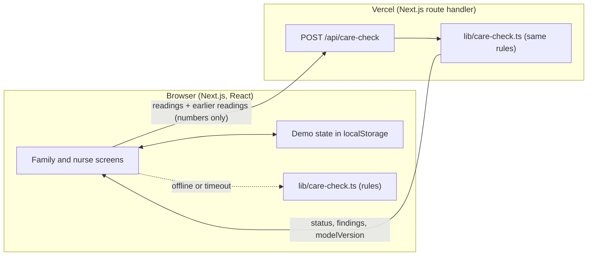

# CareCircle NG

**Verified home nursing for Nigeria's elderly, with an explainable care check that helps a nurse spot when today is different from a person's normal.**

Prepared for the NCS ITDC 2026 Software Development contest. Theme: *Innovative Digital Solutions for Intelligent and Accessible Healthcare Delivery.*

This is a **clickable prototype**. There are no real patients and no real accounts. All people in it are fictional.

## Abstract

About 11.5 million Nigerians aged 60+ have no consistent, dignified home care, while thousands of qualified nurses are unemployed (sources: UN population projections, NANNM data, Nigerian Nurses and Midwives Unemployment Survey 2020; see the pitch deck). CareCircle NG connects families, including those abroad, to NMCN-verified nurses for in-home elderly care, and sends the family a plain-language update on WhatsApp after every visit.

For this contest we added the "intelligent" part: a **Care Check**. At each visit it compares the nurse's readings with the person's *own* recent visits and with fixed clinical limits, suggests a status, and shows the exact rule and numbers behind every reason. A nurse must confirm or change the result, with a written reason, before anyone else sees it.

## Problem and users

| User | Problem |
| --- | --- |
| Family member (often abroad) | Cannot tell whether a parent is really okay. A missed medicine or a slow rise in blood pressure goes unnoticed. |
| Elderly person | Lives alone; the person "checking in" is not medically trained. |
| Nurse | Unemployed or under-used; needs steady, verifiable work across several clients, and the history of each client before she walks in. |

## What the Care Check is, and is not

- It **is** rules-based, explainable decision support. Every result carries the rule ID, the numbers and their units, and a `modelVersion` (`rules-v1`).
- It is **not** a diagnosis, **not** machine learning and **not** clinically validated.
- It reads **numbers only**. It does not read the nurse's notes, so symptoms such as dizziness remain the nurse's judgement. She can raise or lower the status herself, with a reason.
- Why rules and not ML: each person has only a handful of visits, far too little data to train a model responsibly, and a nurse needs to see *why*. `modelVersion` is stamped on every result so a trained model could replace the rules later, once consented data exists and a clinician has validated it.

The rules and their thresholds live in one place, `lib/care-check.ts` (`THRESHOLDS`). The "How this check works" panel on the nurse's checklist is generated from the same constants, so the documentation on screen cannot disagree with the code.

## Healthcare considerations (what is real and what is demo-grade)

| Area | In this prototype |
| --- | --- |
| Human clinical oversight | **Implemented.** A Monitoring or Needs-attention suggestion must be confirmed or changed (with a reason) by the nurse before the report can be submitted. The decision is stored with her ID and the time. The family only sees the nurse's decision. |
| Responsible AI, limits disclosed | **Implemented.** The panel lists what the check can't do (see above). The family dashboard says it is simple rules, not a doctor and not AI. |
| Validation of medical information | **Partly.** Readings outside plausible ranges, or a bottom blood pressure number above the top number, are rejected by both the form and the API. The *rules themselves* are not clinically validated. |
| Consent and confidentiality | **Implemented in the UI.** The person whose data is used is not always the person who signs up, so consent is per relative. A family member agrees, in one plainly worded checkbox, to share readings with the nurse and care circle and to compare each reading with the person's own earlier visits. They can switch that comparison off later. The nurse then records the elder's own yes in person before check-in, and cannot check in without it. A Privacy and consent page shows who can see the data, lets the family switch the personalised check on or off (which really changes what the Care Check uses), shows a history of changes, and offers a data download and a deletion request. The check API receives readings only (no name, address or contact), stores nothing and returns `Cache-Control: no-store`. All data is fictional and kept in the browser's `localStorage`; there is no database, so no encryption at rest. The deletion request is recorded but nothing is deleted. |
| Secure authentication and access control | **Not real.** Sign-in is simulated: any six digits are accepted. Screens are scoped (a family only sees its own relative, a nurse only her own visits), but that is enforced in the browser only. A real build needs server-side auth and role checks. |
| Accessibility | **Implemented in the UI.** 44px+ tap targets, statuses always carry a text label (never colour alone), reduced-motion support, skip link, plain language, units and dates on every number. |
| Low-bandwidth and offline | **Partly.** The visit checklist saves every keystroke locally and keeps working offline (a demo switch simulates losing signal). The Care Check falls back to running the same rules on the phone, and the result says so. Offline sync of the final report is simulated. |

## Architecture



Flow for one visit: the nurse enters vitals, the check runs (server first, on-device if there's no connection), the nurse confirms or changes the suggestion, and on submit the visit record, the elder's status line and the family's view are all derived from the same records.

Status is **derived, not typed**: `lib/elder-status.ts` computes each visit's flag and each elder's status and status line from the visit records and the nurse's decisions. `createSeedState` throws at build time if the rules ever stop reproducing the demo's story (a client with four normal visits, one flagged and one resolved), so the seed data cannot silently drift from the rules.

## Data model (demo)

The demo keeps one `DemoState` object (`lib/mock-data.ts`) in `localStorage`:
`Elder` (conditions, medications, derived `careStatus`), `Nurse` (NMCN licence, verified), `Visit` (vitals, medication adherence, GPS check-in and check-out, derived `flagged`, and `careCheck` holding the result and the nurse's `decision`), plus plans, assignments and onboarding drafts.

## Tech stack

Next.js 16 (App Router) and React 19, TypeScript, Tailwind CSS 4, lucide-react icons. Deployed on Vercel. Rule tests use Node's built-in test runner, so there are no extra dependencies.

## Run it

```bash
npm install
npm run dev        # http://localhost:3000
npm test           # rule tests
npm run lint
npm run build
```

Try it: **Join as a nurse** (or use the demo navigator) → today's visits → Joseph Okafor → check in → checklist. Enter a top number of 148, bottom 92, pulse 88, any temperature and weight, and choose a medication answer. The Care Check explains why it suggests *Monitoring* and asks you to confirm or change it. Submit, then open the family dashboard to see the status and reasons.

## Testing and known limitations

- `npm test` runs 13 tests of the rules and the input validation: a normal reading stays green; a jump above a person's own usual is flagged with numbers and units; the same reading is *not* flagged for someone whose usual is already that high; one odd earlier reading doesn't skew the usual; critical readings go red; a climb is caught for a new client; missing medication and fever are handled; impossible readings and extra fields (such as a name) are rejected or dropped.
- The seed invariant above guards the demo story at build time.
- **Not tested yet:** automated browser tests and a formal accessibility audit.
- Known limits: general adult limits (not adjusted for conditions or medicines); no reading of free-text notes; fewer than three earlier visits means no personal usual; no real authentication, database or encryption; earlier readings are sent in the request body instead of being read from a server-side record.

## Future work

1. Real authentication with role-based access (family, nurse, coordinator) and a database with encryption at rest.
2. Clinical review of the rules by a licensed clinician, then thresholds adjusted for conditions and medicines.
3. Escalation to a partner doctor and to emergency services (LASEMS/112 in Lagos), as set out in the pitch deck.
4. Once consented data exists: evaluate a trained model against these rules, using `modelVersion` to compare them side by side.
5. Real WhatsApp delivery and offline sync of reports.

## Project layout

```
app/api/care-check/      the one server route
lib/care-check.ts        rules, thresholds, validation (no imports; runs on server and device)
lib/care-check-client.ts server call with on-device fallback
lib/elder-status.ts      derives flags and status lines from visit records
lib/visit-flow.ts        the nurse's visit workflow, including the check and decision
lib/mock-data.ts         seed data and the build-time invariant
components/nurse/visit/  checklist and Care Check panel
components/family/       what the family sees
```
