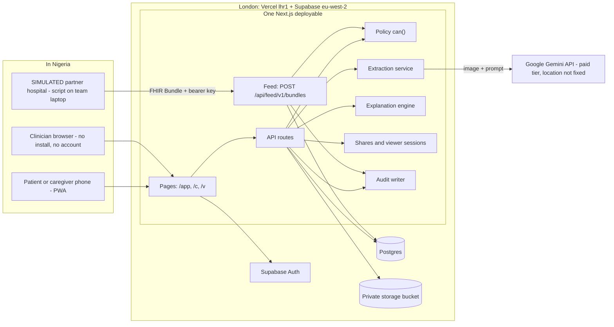
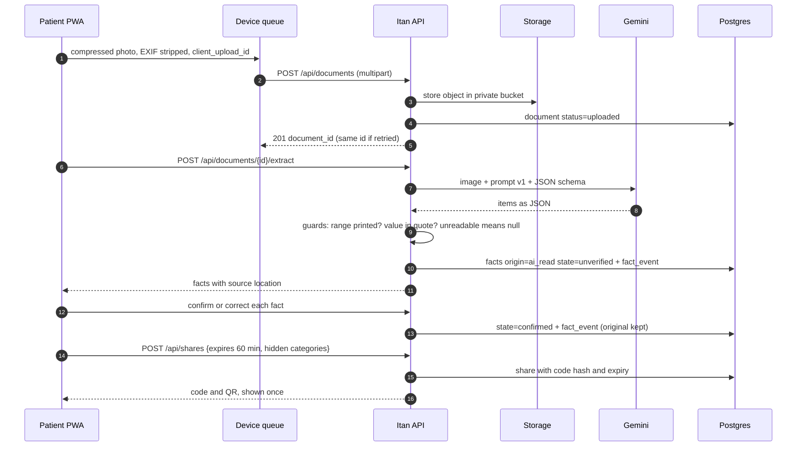
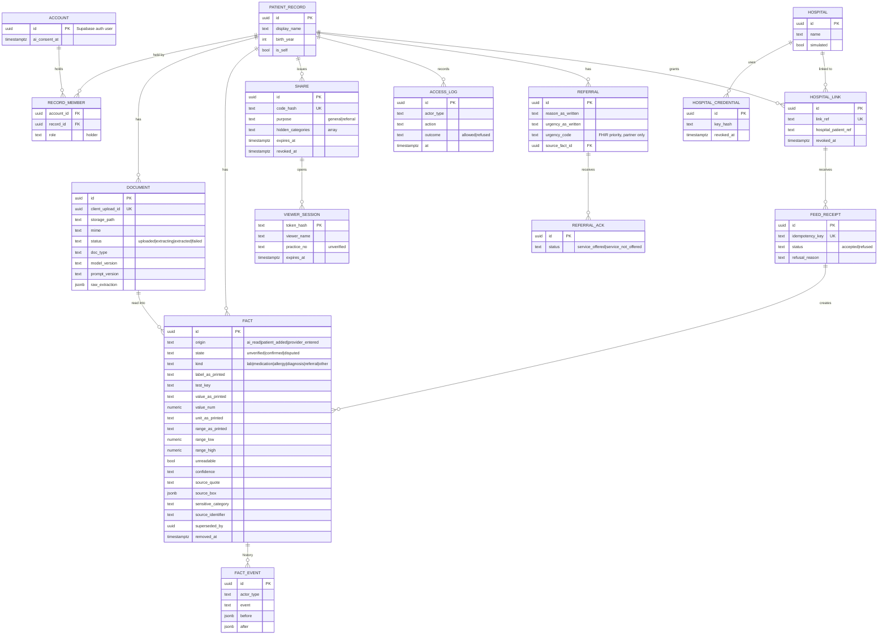
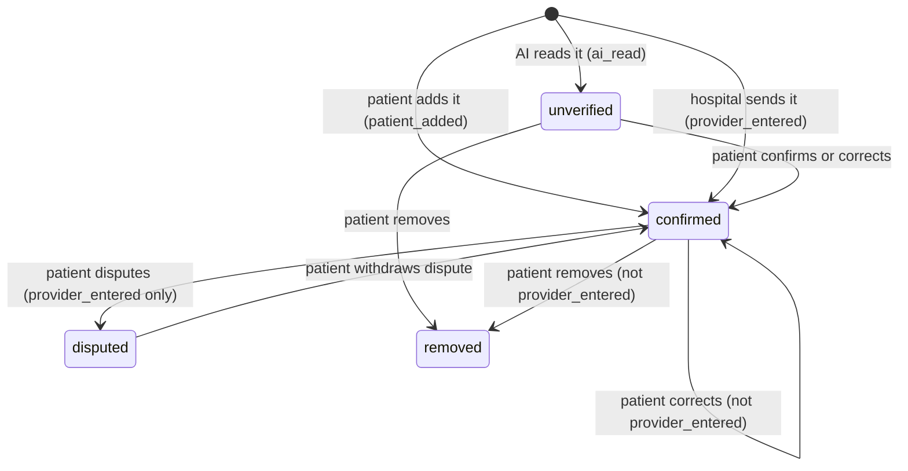

# Itan: System Design (Stage 2)

Nov 12, 2026 · @Mowa · Status: **design-freeze candidate**, to be frozen Fri 13 Nov 12:00

## 0. Summary

Itan is built as **one Next.js (TypeScript) deployable** on Vercel, backed by **one Supabase project** (Postgres, private file storage, auth), both in **London**. Document reading uses the **Google Gemini API** with a JSON schema. A **simulated partner hospital** is a separate script that talks to Itan only through its public, write-only feed.

The design delivers the 14 MUSTs (FR-01 to FR-14) as one spine. The SHOULDs attach to tables and seams that exist from day one, so adding them is new code, not rework:

- `record_member` exists from the start, so caregivers (FR-18) need no schema change.
- Every fact carries `origin`, `state`, `test_key` and `sensitive_category` from the start. Hidden categories (FR-15), last-value comparison (FR-24) and provider-entered facts (FR-27) need no migration.
- Uploads always go through a device queue, so the offline queue (FR-16) is already in place once the app shell is cached.
- The partner feed (FR-26) writes the same `fact` rows as extraction, with `origin = provider_entered`.

**Assumption carried from Stage 1:** the extraction test (Prep B) has not been run; there is no prepB-handoff.md. This design assumes **printed documents and lab-issued digital PDFs only**. Handwriting is out unless Prep B shows it works.

**Two findings change the Stage 1 plan:**

1. **Gemini's terms forbid using it to give medical advice.** So Gemini only *reads* documents. The plain-language explanation (FR-09) is produced by our own code from the range printed on the document plus a short glossary the team writes. This also satisfies NFR-17 and NFR-20 more strongly than an AI-written explanation would.
2. **Gemini's free tier lets Google use what we send, including human review.** The design requires a **billed (paid-tier) Google Cloud project** for any real data. With synthetic contest data, the free tier is a tolerable fallback if billing fails, and the limitations list must say so.

## 1. Context and constraints

| Constraint | Effect on design |
| --- | --- |
| 2 developers, language-agnostic, Fri 13 noon to Mon 16 | One language end to end, one deployable, no infrastructure to run |
| Code in the organisers' GitHub repo by Tue 17 | Develop in a team repo, push to the organisers' repo on Tue; deploy from the team repo |
| No real patient data (Stage 1) | Synthetic demo documents and a synthetic partner hospital |
| Venue internet unknown | Hosted app plus phone hotspot; seeded demo record; backup video (Stage 6) |
| Judging criteria unknown | Design favours a clean end-to-end demo and evidence for the seven healthcare considerations |
| Prep B not run | Printed and digital PDF only; extraction behind one adapter so the provider or prompt can change |

## 2. Decisions at a glance

| # | Decision | Traces to |
| --- | --- | --- |
| D1 | One Next.js 16 app (TypeScript): patient PWA, clinician pages, API routes, feed | All FRs; "one deployable" constraint |
| D2 | Supabase in London (eu-west-2): Postgres, private Storage bucket, Auth (email + password) | FR-01, NFR-02, NFR-04 |
| D3 | Vercel functions pinned to London (lhr1), next to the database | NFR-10, NFR-11 |
| D4 | Gemini reads documents into a JSON schema; our code checks every value against the printed text | FR-03 to FR-05, NFR-15, NFR-17, NFR-18 |
| D5 | Explanations are deterministic code plus a team-written glossary, never LLM-generated | FR-09, NFR-19, NFR-20, Gemini terms |
| D6 | One policy function `can(actor, action, resource)` decides every permission; database row-level security is deny-all as a backstop | NFR-01, NFR-06, NFR-22 |
| D7 | Share code = 8 characters of Crockford base32 (2^40 values), stored only as a keyed hash, default expiry 60 minutes | FR-10, FR-11, NFR-05 |
| D8 | Clinician reads through a short viewer session opened by the code; the share is re-checked on every request | FR-11, FR-12, NFR-06 |
| D9 | Partner feed = one write-only endpoint taking a FHIR R4 Bundle subset, bearer key per hospital, idempotency key required | FR-25 to FR-27, NFR-22 to NFR-24 |
| D10 | Upload is queue-first on the device (IndexedDB), idempotent on the server | FR-02, FR-16, NFR-12 |
| D11 | Urgency and reason are only ever carried verbatim from a source (partner ServiceRequest or a confirmed referral-letter quote) | FR-14, NFR-19 |
| D12 | Feature freeze moves to **Sun 15, 22:00** (the playbook said Saturday); the schedule slipped by a day | Playbook revised plan |

## 3. Stack decision

**Decision: TypeScript end to end, one Next.js app, Supabase, Gemini.** Your starting lean holds, with four changes:

- **Postgres, not SQLite.** Vercel functions have no persistent disk, so SQLite would force us onto a VM.
- **Supabase rather than separate database, storage and auth vendors.** One account, one region, one set of keys.
- **Explanations are not generated by the LLM** (section 10).
- **Uploads go through a device-side queue from day one.**

| Layer | Choice | Why | Verified? |
| --- | --- | --- | --- |
| Framework | Next.js 16.x, App Router, TypeScript | One codebase for the PWA, the server-rendered clinician view and the API. 16.3 is the current release | Yes: nextjs.org blog |
| Hosting | Vercel Hobby, functions in `lhr1` (London) | Push-to-deploy. Hobby functions run up to 300 s, well above the 30 s extraction target. The default region is `iad1` (Washington), so it **must be changed** | Yes: Vercel limits and regions docs. Hobby's non-commercial-use condition: **not verified**, check before signing up |
| Database, storage, auth | Supabase Free, region West Europe (London) `eu-west-2` | Postgres with JSONB for raw extractions; private buckets; email + password auth. **No Africa region exists**; London is the nearest | Region list: yes. Free projects pause after \~7 days of inactivity: yes. Password hashing and encryption at rest: **provider claims, not verified** |
| ORM and migrations | Drizzle ORM + drizzle-kit, `postgres` driver via the Supabase pooler | Typed schema shared with the API; plain SQL migrations in the repo | **Not verified** against current docs; fallback is `supabase-js` |
| Validation | Zod | One schema for the extraction output, the API bodies and the feed bundle | Gemini's JS example uses Zod with `responseJsonSchema`: yes |
| AI | `@google/genai` SDK, a **stable** Gemini Flash model pinned in `GEMINI_MODEL` | Reads images and PDFs; structured JSON output | Structured output: yes. Model names change monthly; pick the stable Flash model from `models.list` on Friday. Inline file limit around 20 MB: from a mirror of Google's docs, **not verified on the official page** |
| PWA | Hand-written manifest and service worker (\~60 lines), IndexedDB via `idb-keyval` | App shell offline; queued uploads | Not verified; small and replaceable |
| UI | Tailwind CSS (create-next-app default), no component library | Speed | — |
| QR codes | `qrcode` npm package | Share code as QR | Not verified |
| Tests | Vitest for the policy matrix, feed refusals and extraction guards; one smoke script against the deployed URL | Evidence for Stage 4 | — |

### The main alternative and why it lost

**Python (FastAPI) with server-rendered pages and HTMX, SQLite on a single VM.** It is attractive if one developer is strongest in Python, and Python is good at document handling. It lost for four reasons:

1. The offline queue and camera compression must be written in browser JavaScript anyway, so Python means two languages.
2. A VM means running and patching a server for four days.
3. Pydantic schemas could not be shared with the browser code.
4. Vercel and Supabase give TLS, deploy previews and backups for free.

**Firebase** also lost: Itan's data is relational (records, facts, events, shares, links), and the access log and last-value comparison are relational queries.

### Risks of this stack

| Risk | Likelihood | Mitigation |
| --- | --- | --- |
| Google Cloud billing fails with a Nigerian card, so we cannot get the paid tier | Medium | Try first thing Friday. Fallback: free tier with synthetic documents only (no personal data, as the terms require), stated in the limitations list |
| Gemini accuracy on our documents is unknown | High | Run Prep B on Friday morning using the extraction harness from C06; restrict the document types to what passes NFR-15 |
| Next.js 16 changes catch a developer out (async params, `proxy.ts` replacing middleware) | Medium | Start from `create-next-app@latest`; keep routes simple |
| Drizzle and the Supabase pooler need config friction | Low–medium | Budget 1 hour; fall back to `supabase-js` |
| Vercel request body limit on uploads (believed 4.5 MB, **not verified**) | Low for photos (≤500 KB) | Refuse PDFs over the limit with a clear message |

## 4. Architecture



Everything inside the London box is one repository and one deploy. The simulated hospital lives in `tools/sim-hospital/` in the same repository but is **not deployed**; it knows only the public URL and its own key, exactly as a real hospital system would.

### Components

Every component traces to a requirement. Hours are rough estimates for one developer. **Dev A** = patient and clinician screens; **Dev B** = data, AI, security, feed. Assign names at the freeze.

| ID | Component | Purpose | FR / NFR | Owner | Hours | Day |
| --- | --- | --- | --- | --- | --- | --- |
| C01 | Platform skeleton | Repo, Next.js app, Vercel project in lhr1, Supabase project in London, env vars, README stub | NFR-02 | B | 3 | Fri |
| C02 | Data layer | Drizzle schema, migrations, seed (facilities, glossary, drug–allergy rules, simulated hospital) | FR-01–14, NFR-16, NFR-24 | B | 4 | Fri |
| C03 | Auth, records, consent | Email + password sign-up, consent screen with AI disclosure, `patient_record` + `record_member` | FR-01, NFR-03, NFR-04 (FR-18 ready) | A | 3 | Fri |
| C04 | Policy module | `can(actor, action, resource)` plus one test per matrix cell | NFR-01, NFR-06, NFR-22 | B | 2 | Fri |
| C05 | Capture and upload | Camera or file input, compress to ≤500 KB, strip EXIF, queue-first upload with `client_upload_id` | FR-02, NFR-09, NFR-12 | A | 4 | Fri |
| C06 | Extraction service | Gemini adapter, prompt v1, Zod schema, guards, status on the document row; doubles as the Prep B harness | FR-03, FR-04, FR-05, NFR-10, NFR-13, NFR-15, NFR-17, NFR-18 | B | 6 | Fri–Sat |
| C07 | Fact review and correction | Each fact beside its source crop; confirm, correct, remove; add a fact; tag sensitive category | FR-05, FR-06, FR-07, FR-15 (tagging), NFR-16 | A | 5 | Sat |
| C08 | Timeline | Confirmed and unverified facts by date and document | FR-08 | A | 2 | Sat |
| C09 | Explanation engine | Compare value to the printed range in code; glossary sentence; questions to ask | FR-09, NFR-17, NFR-19, NFR-20 | B | 3 | Sat |
| C10 | Shares and viewer sessions | Code generation, keyed hash, expiry, revocation, rate limit, hidden-category filter | FR-10, FR-11, FR-15, NFR-05, NFR-06 | B | 4 | Sat |
| C11 | Clinician view | One-screen summary with origin and state badges, source image on tap, previous value | FR-12, FR-24, NFR-07, NFR-08, NFR-11, NFR-16 | A | 5 | Sat |
| C12 | Access log | Append-only writes from C10, C11, C13 and C15; patient screen | FR-13, NFR-23 | B (writes), A (screen) | 2 | Sat |
| C13 | Referral packet and acknowledgement | Packet for patient and clinician; reason and urgency carried with their source; "received, service offered here"; short facility list | FR-14, FR-19, FR-20, NFR-19 | A + B | 5 | Sun |
| C14 | Hospital link | Patient links a partner, gets a link reference, can revoke | FR-25, NFR-23 | B | 2 | Sun (if go) |
| C15 | Partner feed API | Write-only bundle intake, validation, provider-entered facts, refusals | FR-26, FR-27, NFR-22, NFR-24 | B | 5 | Sun (if go) |
| C16 | **Simulated hospital (SIMULATED)** | CLI that plays a partner system: sends results and a referral, tries the four refused cases | Demo of FR-25–27 | B | 2 | Sun (if go) |
| C17 | Offline app shell | Service worker caching the shell; queue retry UI | FR-16, NFR-12 | A | 2 | Sun |
| C18 | Drug–allergy advisory | Small hand-built rule list; non-blocking banner | FR-17, NFR-21 | B | 2 | Sun |
| C19 | Caregiver records | Create a record for someone else; record switcher | FR-18 | A | 2 | Sun |

Total ≈ 63 hours, of which the MUST spine (C01–C13) is ≈ 48. Two developers have about 60 working hours from Friday noon to Sunday night, so **the cut order is real, not theoretical**. FR-21 (PDF export) is served by a print stylesheet on the packet page; FR-22 (search) is not designed; FR-23 stays excluded.

### Repository layout

```
app/            (patient)/app/*  clinician /c and /v  api/*
lib/db/         schema.ts  migrations/  seed.ts
lib/policy.ts   can() — the only place permissions are decided
lib/extract/    gemini.ts  schema.ts  guards.ts  prompt-v1.md
lib/explain/    engine.ts  glossary.ts
lib/share/      codes.ts  session.ts
lib/feed/       fhir-subset.ts  intake.ts
lib/audit.ts
tools/sim-hospital/   SIMULATED — cli.ts  fixtures/*.json  README.md
tests/          policy.test.ts  feed.test.ts  guards.test.ts
```

## 5. Key flows

### 5.1 Capture to share



If the connection drops after step 5, the queue retries with the same `client_upload_id` and gets the same `document_id` back. If it drops during extraction, the patient reopens the document and the app reads its status (`uploaded`, `extracting`, `extracted`, `failed`); extraction is re-run only if it is not `extracted`.

### 5.2 Clinician read

```mermaid
sequenceDiagram
  autonumber
  participant C as Clinician browser
  participant A as Itan API
  participant DB as Postgres
  C->>A: GET /c (code stays in the URL fragment, never sent)
  C->>A: POST /api/view/open {code, name, practice number}
  A->>DB: attempts this IP under limit? share by hash, not expired, not revoked?
  A->>DB: viewer_session + access_log opened
  A-->>C: viewer cookie, HttpOnly, 30 min or until share expiry
  C->>A: GET /v
  A->>DB: re-check share; load facts minus hidden categories
  A-->>C: one-screen summary, server-rendered
  C->>A: tap a fact: GET /v/facts/{id}/image
  A->>DB: access_log viewed image
  A-->>C: 302 to a 60-second signed URL
```

The screen states that the name and practice number were recorded but not verified (Stage 1 Decision 1), and that some items may be hidden by the patient whenever any are.

### 5.3 Referral

The packet is assembled from facts that already exist; Itan writes no clinical content.

1. **Source of reason and urgency.** Either a partner `ServiceRequest` (provider-entered), or a referral letter the patient photographed, where extraction returns `reason_as_written` and `urgency_as_written` verbatim with their source location and the patient confirms the transcription.
2. **Packet contents:** patient identity; reason and urgency **with their source**, or "Not stated by the referring clinician"; allergies and the drug–allergy advisory; current medicines; recent results with printed ranges and previous values; the documents behind each item.
3. **Sharing:** a share with `purpose = referral`. The patient may choose a longer expiry (up to 7 days, to be agreed: see section 17) because the visit may be days later.
4. **Acknowledgement (FR-19):** the receiving clinician taps "Received — service offered here" or "Received — service not offered here". The screen states that this is **not** a statement that a bed is available.
5. **Print:** the packet page has a print stylesheet, so "Save as PDF" in the browser covers FR-21.

### 5.4 Partner link and feed

```mermaid
sequenceDiagram
  autonumber
  participant P as Patient PWA
  participant A as Itan API
  participant H as SIMULATED hospital script
  participant DB as Postgres
  P->>A: POST /api/links {hospital: Demo General (SIMULATED)}
  A->>DB: hospital_link active, link_ref ITN-LNK-7K2Q9MWD
  A-->>P: link reference + QR to give the records officer
  Note over H: Records officer stores link_ref against the hospital number
  H->>A: POST /api/feed/v1/bundles, bearer key, Idempotency-Key
  A->>DB: key valid? link active for this hospital? bundle valid?
  A->>DB: one transaction: facts origin=provider_entered + feed_receipt + access_log
  A-->>H: 202 receipt_id, facts_created
  P->>A: revoke link
  A->>DB: hospital_link revoked_at
  H->>A: POST another bundle
  A-->>H: 403 link_not_active (logged; the patient sees the refused delivery)
```

**Feed contract (v1).**

- `POST /api/feed/v1/bundles` with `Content-Type: application/fhir+json`, `Authorization: Bearer <hospital key>` and `Idempotency-Key: <uuid>`.
- **Body:** a FHIR R4 `Bundle` of type `collection`. The `Patient` carries an identifier with system `urn:itan:link` and the link reference, plus the hospital's own number.
- **Accepted resources:** `Observation` (`code.text`, `valueQuantity` or `valueString`, `referenceRange`, `effectiveDateTime`) and `ServiceRequest` (`reasonCode[].text`, `priority` as routine, urgent, asap or stat, `requester.display`).
- Everything else is refused with 422. We validate this subset with Zod; we do not run a FHIR server.
- **Success:** 202 with `receipt_id`. Replaying the same `Idempotency-Key` returns the same receipt and writes nothing.

**Refusals (the four NFR-22 tests plus two):**

| Case | Response | Logged |
| --- | --- | --- |
| Read attempt (any GET, PUT or DELETE under `/api/feed`) | 405, no body content | feed\_receipt refused |
| Wrong or revoked credential | 401 | feed\_receipt refused |
| Unlinked patient, revoked link, or a link belonging to another hospital | 403 `link_not_active`, the same response for all three so a hospital cannot probe which patients exist | feed\_receipt; access\_log on the patient's record if the link existed |
| Bundle outside the subset | 422 with issue list; nothing written | feed\_receipt |
| Body over 1 MB | 413 | feed\_receipt |
| Same Idempotency-Key again | 200 with the original receipt | — |

A corrected result from a hospital arrives as a new `Observation` with the same `identifier`. The new fact supersedes the old one (`superseded_by`); the old one is kept.

## 6. Data model



Supporting seed tables, not drawn: `facility` (short static list, FR-20), `glossary` (test aliases, a one-line description, questions; **no ranges**, NFR-17), `drug_allergy_rule` (FR-17), `code_attempt` (rate limit).

**Design rules carried into the schema:**

- **Every value is kept as printed.** `value_as_printed`, `unit_as_printed`, `range_as_printed` are never rewritten; `value_num`, `range_low` and `range_high` are only filled when the guards confirm they appear in the printed text. No unit conversion (NFR-18). No range table (NFR-17).
- **Provenance on every fact.** `document_id` with `source_quote` and `source_box` for AI-read facts; `feed_receipt_id` and the hospital for provider-entered facts; the account for patient-added facts (NFR-16).
- **History is append-only.** A correction writes a `fact_event` with `before` and `after`; the AI's original reading is never lost. Provider-entered facts are never updated; a dispute is a state plus an event with the patient's note (NFR-24).
- **FHIR mapping.** A lab fact maps to `Observation`, medication to `MedicationStatement`, allergy to `AllergyIntolerance`, diagnosis to `Condition`, referral to `ServiceRequest`; `origin` maps to `meta.source` plus a provenance extension. This is a mapping for later export, not a FHIR store.

### Fact lifecycle



"Confirmed" means someone vouched for it: the patient, for AI-read and patient-added facts, or the sending facility's system, for provider-entered facts. The origin badge always says which.

## 7. API

| Method and path | Caller | Does | FR |
| --- | --- | --- | --- |
| POST /api/records | Patient | Create a record for self or someone else | FR-01, FR-18 |
| POST /api/consent | Patient | Record AI-processing consent before first capture | NFR-03 |
| POST /api/documents | Patient | Upload one file; idempotent on `client_upload_id` | FR-02, NFR-12 |
| POST /api/documents/{id}/extract | Patient | Run extraction if not already done; return facts | FR-03–05 |
| GET /api/documents/{id} | Patient | Status and facts | FR-03 |
| GET /api/documents/{id}/image | Patient | 302 to a 60-second signed URL | FR-05 |
| GET /api/records/{id}/facts | Patient | Timeline data | FR-08 |
| POST /api/facts | Patient | Add a fact (patient\_added) | FR-07 |
| POST /api/facts/{id}/confirm | Patient | unverified to confirmed | FR-06 |
| POST /api/facts/{id}/correct | Patient | Change fields; event keeps the original | FR-07 |
| POST /api/facts/{id}/remove | Patient | Hide a wrong AI fact; event kept | FR-07 |
| POST /api/facts/{id}/dispute, DELETE the same | Patient | Dispute or withdraw, provider\_entered only | FR-27 |
| GET /api/facts/{id}/explanation | Patient | Deterministic explanation | FR-09 |
| POST /api/shares | Patient | Create a code (expiry, hidden categories, purpose) | FR-10, FR-15 |
| POST /api/shares/{id}/revoke | Patient | Revoke now | FR-11 |
| GET /api/records/{id}/access-log | Patient | Who saw what, and refusals | FR-13 |
| POST /api/referrals, GET /api/referrals/{id} | Patient | Build and preview a packet | FR-14 |
| GET /api/facilities | Patient | Short static list | FR-20 |
| POST /api/links, POST /api/links/{id}/revoke | Patient | Link and unlink a partner hospital | FR-25 |
| POST /api/view/open | Clinician | Code + name + practice number opens a viewer session | FR-10, FR-12 |
| GET /v, GET /v/referral | Clinician | Server-rendered summary and packet | FR-12, FR-14, FR-24 |
| GET /v/facts/{id}/image | Clinician | 302 to a signed URL; logged | FR-05, NFR-16 |
| POST /api/view/ack | Clinician | Referral acknowledgement | FR-19 |
| POST /api/feed/v1/bundles | Partner system | Write-only intake | FR-26, FR-27 |

No endpoint takes a record ID without also checking, through `can()`, that the caller holds that record (NFR-06).

## 8. Roles and permissions

Four actors. A caregiver is a record holder for a record created "for someone else", so they share the patient's row.

| Action | Record holder (patient or caregiver) | Clinician by code | Partner system by credential | No credential |
| --- | --- | --- | --- | --- |
| Upload a document | Allowed | Denied | Denied | Denied |
| See the whole record, including hidden categories | Allowed | Denied | Denied | Denied |
| See the shared summary | Allowed (own) | Allowed while the code is valid | Denied | Denied |
| See facts in a hidden category through a share | — | Denied; told items are hidden | Denied | Denied |
| See the source image of a shared fact | Allowed | Allowed, logged | Denied | Denied |
| Confirm or correct an AI-read fact | Allowed | Denied | Denied | Denied |
| Edit a provider-entered fact | Denied (may dispute) | Denied | Denied | Denied |
| Create or revoke a share code | Allowed | Denied | Denied | Denied |
| Read the access log | Allowed | Denied | Denied | Denied |
| Set urgency or reason | Denied for everyone: carried from a source only | Denied | Denied (sends it in a ServiceRequest) | Denied |
| Acknowledge a referral | Denied | Allowed with a referral share | Denied | Denied |
| Link or unlink a hospital | Allowed | Denied | Denied | Denied |
| Write through the feed | — | — | Allowed only for an active link to that hospital | Denied |
| Read anything through the feed | — | — | Denied (no route exists) | Denied |

`lib/policy.ts` implements exactly this table and `tests/policy.test.ts` has one test per cell. The interactive permissions tester uses the same table.

## 9. Security and privacy

| Threat | Control | Requirement |
| --- | --- | --- |
| Someone guesses a share code | 2^40 code space; 5 failed attempts per IP per 10 minutes, then 429; refusals logged | NFR-05 |
| A database leak exposes live codes | Only `HMAC-SHA256(pepper, code)` is stored; the pepper lives in an environment variable | NFR-05 |
| A clinician keeps reading after revocation | The share is re-checked on every request, not only at open; cookie lifetime ≤ share expiry | FR-11 |
| A record URL is guessed | Record content is only served via a session that `can()` checks; IDs are UUIDs | NFR-06 |
| A document image link is passed on | Private bucket; signed URLs live 60 seconds; every image view logged | NFR-16 |
| The code leaks through logs or referrers | Code carried in the URL fragment (not sent to servers); `Referrer-Policy: no-referrer`; `Cache-Control: no-store` on /v | NFR-06 |
| A photo reveals location | EXIF stripped on the device by re-encoding before upload | Confidentiality |
| A partner key leaks | Keys stored hashed, revocable; write-only scope; per-hospital link check | NFR-22 |
| A replayed bundle duplicates facts | Idempotency-Key unique per hospital | NFR-24 |
| A hospital probes which patients exist | Unlinked, revoked and other-hospital links get the identical 403 | NFR-22 |
| Browser code talks to the database directly | Row-level security on and deny-all for the public role; only the server's service key reads and writes | NFR-01 |
| Weak passwords | Minimum 8 characters, enforced in the auth settings and the form | NFR-04 |
| Extraction sends data abroad | Disclosed on the consent screen before first capture, naming Google and the UK (section 9.1) | NFR-03 |

### 9.1 Where data leaves Nigeria

| Data | Goes to | Stored? | Verified |
| --- | --- | --- | --- |
| Every request from the patient and clinician | Vercel edge, then functions in London (lhr1) | Logs only | Region option: yes |
| Records, facts, logs, account emails, password hashes | Supabase Postgres, London (eu-west-2) | Yes | Region: yes |
| Document images and PDFs | Supabase Storage, London | Yes | Region: yes |
| Document image + prompt during extraction | Google Gemini API | Paid tier: not used to improve products; logged for a limited period for abuse detection; may be stored transiently or cached **in any country** where Google has facilities | Yes: Gemini API Additional Terms |
| The same, if we fall back to the free tier | Google | Used to improve Google products; **human reviewers may read it** | Yes: same terms |
| Simulated hospital bundles | From a team laptop in Nigeria to London | Yes, as facts | — |

**All patient data at rest is in the United Kingdom.** The Nigeria Data Protection Act's rules on cross-border transfer and on health data as sensitive data must be read from the statute before any compliance claim (Stage 1 open item). This is not legal advice. A future version could host in Nigeria; this version does not.

## 10. Responsible AI design

**What Gemini does:** transcribe. **What Gemini never does:** explain, advise, rank urgency, fill gaps.

- **Gemini's terms bar this use.** They say the services may not be used in clinical practice or to provide medical advice. Itan's AI use is limited to reading a document the patient already holds into fields. Every interpretive sentence the patient sees comes from our code and a glossary a person wrote. We should say this plainly in the defence. It is still a judgment call: we have not had a lawyer read the terms.
- **Extraction contract.** For each item the schema returns: `label_as_printed`, `value_as_printed`, `unit_as_printed`, `range_as_printed`, `flag_as_printed`, `readable`, `confidence`, `source_quote` (verbatim) and a source box. For referral letters it also returns `reason_as_written` and `urgency_as_written`. The prompt says: copy only what is printed; if you cannot read it, set `readable` to false and leave the value empty; never infer a range, unit or value.
- **Guards in our code**, after the model answers:
  1. `value_num` is kept only if its digits appear in `value_as_printed`.
  2. `range_low` and `range_high` are kept only if they appear in `range_as_printed`; otherwise only the text is kept.
  3. `value_as_printed` must appear inside `source_quote`.
  4. `readable = false` forces the value to empty and `unreadable = true` (FR-04).
  5. Medication and allergy items are flagged "check carefully" unless confidence is high. Nothing is ever auto-confirmed.
- **Explanation engine (FR-09).** Example: *"Your Haemoglobin was 9.8 g/dL. The range printed on this report is 12.0–16.0 g/dL. Your result is below that printed range."* Then a glossary sentence (what the test measures, no causes), then two or three fixed questions to ask. If no range is printed: "This report does not print a range for this test, so Itan cannot compare it." If the test is not in the glossary: "Itan has no description of this test yet." The glossary must be reviewed by someone with clinical knowledge, or the limitations list says it was not (NFR-20).
- **Disclosure (NFR-13).** Every screen with AI-read content carries: "Read by AI from your document. It may contain errors. Not medical advice."
- **Bounding boxes.** We ask for the location of each item so the review screen can crop to it. Gemini's box format is **not verified** here. Fallback: the whole page, with the quote highlighted underneath.
- **Model and prompt are recorded** on each document (`model_version`, `prompt_version`), so Prep B results stay tied to the model that produced them.

## 11. Low bandwidth and offline

- **Patient photos:** compressed on the device to the longest edge ≤1600 px and JPEG quality stepped down until ≤500 KB (NFR-09). They are queued in IndexedDB before any network call, so a dropped connection never loses a capture (NFR-12, FR-16). The queue retries on app open, on the browser `online` event and on a "Retry now" button. We do not rely on Background Sync, whose iOS support is **not verified**.
- **App shell:** cached by the service worker so the app opens offline and shows the queue and the last-loaded timeline.
- **Clinician view:** server-rendered HTML, no client framework payload needed to read it, no images until tapped. Target under 300 KB for the first screen (NFR-11), checked with Chrome throttling in Stage 4.
- **Extraction** is synchronous inside one function call (Hobby allows up to 300 s), with the target of 30 s on throttled 3G (NFR-10). No job queue.

## 12. Accessibility

Body text 16 px minimum and readable at 200% zoom; contrast 4.5:1; every control labelled; state is never shown by colour alone: badges carry words such as "Unverified" and "Sent by hospital" (NFR-07). The clinician view works at 360 px wide (NFR-08). The capture button is large, with a file-picker fallback for phones where the camera input fails.

## 13. Screens

Key screens, wireframed in the interactive design lab:

1. Consent with AI disclosure
2. Home and timeline
3. Capture and upload queue
4. Review a document: facts beside the source, confirm or correct
5. Explanation of one result
6. Share: expiry, hidden categories, code and QR
7. Access log
8. Clinician: enter code, name and practice number
9. Clinician one-screen summary
10. Referral packet with acknowledgement
11. Link a hospital

## 14. What we rejected and why

| Rejected | Why | Traces to |
| --- | --- | --- |
| Microservices or a separate extraction worker | No FR needs separate scaling; extraction fits in one function call | "One deployable" constraint |
| A job queue (Redis, BullMQ, QStash) | The document row's status plus device-side retries handle drops; nothing runs after the request | NFR-12 |
| SQLite | No persistent disk on Vercel functions | — |
| Clinician accounts or a clinician app | Stage 1 Decision 1 | FR-12 |
| Hospital screens inside Itan | Stage 1 Decision 8: no double entry | FR-25–27 |
| Native app | Out of scope; PWA covers camera and offline | Scope |
| Gemini Files API | Keeps files at Google beyond the request; inline upload is enough for ≤500 KB images | Confidentiality |
| LLM-written explanations | Gemini terms bar medical advice; NFR-17, NFR-19 and NFR-20 favour deterministic text | FR-09 |
| OCR engine (Tesseract) plus an LLM | Two steps, weaker on phone photos; Prep B will tell us if Gemini alone fails | FR-03 |
| A full FHIR server (HAPI) | Heavy to run; we only need a validated subset | FR-26 |
| HMAC-signed requests or mutual TLS on the feed | Stronger, but more time than we have; bearer key over TLS plus idempotency now, signing listed as future work | NFR-22 |
| `next-pwa` plugin | Compatibility risk with Next 16; a hand-written service worker is short | FR-16 |
| A PDF generation library | A print stylesheet gives "Save as PDF" for free | FR-21 |
| Phone number sign-in with SMS codes | SMS provider setup and cost | FR-01 |
| Row-level security as the main permission system | Splits permission logic between SQL and TypeScript; one `can()` is easier to test and defend | NFR-01 |
| WebSockets for live feed arrivals | The patient refreshes; nothing needs push | — |
| Vercel AI SDK | An extra layer; our adapter already isolates the provider | — |

## 15. Risks to the build

| Risk | Effect | Mitigation | Owner |
| --- | --- | --- | --- |
| Prep B shows poor accuracy | Demo restricted to fewer document types | Run it Friday 08:00–11:00 using the C06 harness; decide types at the freeze | B |
| Billing for Gemini fails | Free tier only; data used by Google | Synthetic data only; disclose | B |
| Fewer hours than the MUST spine needs | MUSTs incomplete on Sunday | Checkpoints below; cut SHOULDs first; narrow document types inside the MUSTs; never cut FR-04, FR-05, FR-06 | Both |
| Gemini model renamed or deprecated | Extraction breaks | Model name in an env var; stable models only | B |
| Venue internet fails | Live demo fails | Hotspot; backup video; demo account pre-seeded | Both |
| The organisers forbid AI APIs | Extraction cannot be shown live | Patient-added facts still work end to end; pre-extracted demo documents; ask the organisers now | Both |
| Gemini terms forbid apps likely to be used by under-18s | Terms breach | Itan is for adults; a record for a child is out of scope in this version; confirm both developers are 18 or over | Both |

## 16. Build plan, checkpoints and cut order

| When | Checkpoint | Pass condition |
| --- | --- | --- |
| Fri 08:00–11:00 | Prep B | 10–15 synthetic documents scored with the C06 harness; document types decided |
| Fri 12:00 | **Design freeze** | Checklist in section 17 complete |
| Fri 23:00 | **CP1 Walking skeleton** | On the deployed URL: sign up, upload one printed lab result, see its facts listed as unverified |
| Sat 20:00 | **CP2 MUST spine** | On the deployed URL: confirm, correct, timeline, explanation, share code, clinician view, access log |
| Sat 20:00 | **Partner feed decision** | Go if CP2 passed; otherwise FR-25 to FR-27 are cut and the packet takes reason and urgency from a photographed letter |
| Sun 22:00 | **CP3 Feature freeze** | Referral packet done; SHOULDs per the cut order; no new features after this |
| Mon 16 | Stage 4 evidence | Tests, throttled-network runs, screenshots, limitations list |
| Tue 17 | Push and rehearse | Code and README in the organisers' repo; two rehearsals; backup video |

**Cut order (worst first, from Stage 1):** FR-22, FR-21, FR-18, FR-20, FR-17, FR-24, FR-19, FR-27, then FR-25 and FR-26 together, then FR-15, then FR-16. Build order for SHOULDs: FR-25 and FR-26 first, then FR-24. **Never cut FR-04, FR-05 or FR-06.**

## 17. Design-freeze checklist

Each item has a pass test. All must pass by Fri 12:00, or be explicitly waived in the team chat.

1. **Stack agreed.** Both developers reply "agree" to section 3 in the team chat.
2. **Names on the build board.** Dev A and Dev B are named, and every component C01–C19 has an owner and a day.
3. **Vercel.** The project exists with function region `lhr1`. A deployed test route reports its region as lhr1 in the function logs.
4. **Supabase.** The project exists in West Europe (London). The dashboard shows the region.
5. **Gemini.** An API key exists on a billed Google Cloud project, or the free-tier fallback is recorded as a known limitation. `tools/extract-test.ts` returns schema-valid JSON for one synthetic lab report.
6. **Model pinned.** `GEMINI_MODEL` names a model shown as stable in the current `models.list` output.
7. **Prep B.** The test has run and document types are fixed, or the freeze records "printed and digital PDF only, accuracy unmeasured".
8. **Schema.** `npm run db:migrate` applies to an empty database with no errors, and `npm run db:seed` loads the simulated hospital, the facilities, the glossary and the rules.
9. **API contract.** `docs/api.md` lists every route in section 7, with no route missing.
10. **Policy tests written.** `tests/policy.test.ts` has one case per cell of the section 8 table (they may fail until C04 is built).
11. **Feed fixture.** `tools/sim-hospital/fixtures/results.json` validates against the feed subset schema.
12. **Demo documents.** At least six synthetic documents exist with an answer key: two printed lab results, two lab PDFs, one prescription and one referral letter. No real patient appears in any.
13. **Consent text.** Drafted, and a reader can state the three NFR-03 facts from it: an AI service reads the documents, where processing happens, and what is retained.
14. **Wireframes.** Both developers have clicked through the screens in the design lab and agreed them.
15. **Open decision settled:** maximum expiry for referral shares (proposed: 7 days).
16. **Saturday decision owner** named for the 20:00 partner-feed go/no-go.

## 18. Verification log

**Verified against official documentation on 12 Nov 2026:**

- Gemini structured output accepts a JSON Schema through `responseJsonSchema`, with Zod supported in the JavaScript SDK.
- The Gemini API Additional Terms (effective 23 Mar 2026): no use in clinical practice or for medical advice; developers 18+ and no apps directed at under-18s; unpaid use may be used to improve Google products with human review; paid use is not used for that and may be cached in any country; access is paid only through a Cloud project with active billing.
- The Gemini models page lists stable Flash models and states that stable models are the ones for production.
- Vercel Hobby functions run up to 300 seconds; the default function region is `iad1` and can be changed; `lhr1` and `cpt1` exist.
- Supabase regions include London and contain no African region; free projects pause after about a week of inactivity.
- Next.js 16.3 is the current release line.

**Not verified, labelled where used:** Vercel's request body limit; the Hobby plan's non-commercial-use rule; Supabase password hashing and encryption at rest; Drizzle with the Supabase pooler; Gemini's bounding-box format; the inline file size limit on the official page; iOS support for Background Sync; the `qrcode` and `idb-keyval` packages; whether Nigeria is a Gemini-available region (if the key works from Nigeria, it is).

## Sources

- [Gemini API Additional Terms of Service](https://ai.google.dev/gemini-api/terms)
- [Gemini API: Structured outputs](https://ai.google.dev/gemini-api/docs/structured-output)
- [Gemini API: Models](https://ai.google.dev/gemini-api/docs/models)
- [Vercel Functions limits](https://vercel.com/docs/functions/limitations)
- [Vercel regions](https://vercel.com/docs/regions)
- [Supabase available regions](https://supabase.com/docs/guides/platform/regions)
- [Supabase: free Postgres for side projects (pausing)](https://supabase.com/kb/faqs/platform/free-postgres-for-side-projects)
- [Next.js 16.3](https://nextjs.org/blog/next-16-3)
- Itan: Stage 1 Requirements (FR and NFR numbering): `docs/REQUIREMENTS-STAGE1.md`
